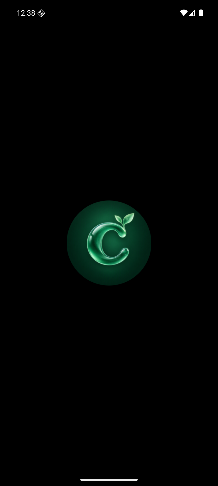
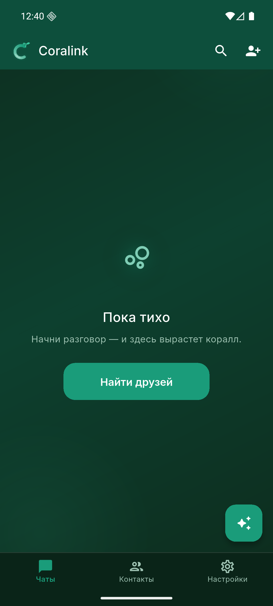

# Coralink

**Grow your conversations.**
Coralink — кросс-платформенный мессенджер со сквозным шифрованием и «природным»
интерфейсом: сообщения прорастают, уведомления светятся, старые разговоры уплывают
в нижний слой. Работает поверх собственной инфраструктуры (Node.js-сервер) и
разворачивается одной ссылкой через Tailscale.

<p align="center">
  
  
</p>

---

## Что реализовано

| Блок | Статус |
|---|---|
| Flutter-приложение: Android, Windows, Web (+ iOS-каркас) | ✅ |
| Сквозное шифрование 1-на-1: Signal Protocol (X3DH + Double Ratchet) | ✅ |
| Сквозное шифрование групп: симметричные AES-GCM ключи, распределение через 1-на-1 Signal-канал | ✅ |
| Аутентификация по никнейму и паролю (scrypt на сервере), без SMS-кода | ✅ |
| Поиск пользователей по никнейму | ✅ |
| Сообщения: текст, фото, файлы (≤ 6 МБ), аудио- и видеосообщения, «видеокружки» (встроенная камера, без лимита длины) | ✅ |
| Коралловые стикеры: 8 живых векторов, пикер 4×2, отправка и получение с анимацией | ✅ |
| Тамагочи: личный питомец и общий с приглашением в чат или группе, серверная синхронизация, рост по XP, четыре действия | ✅ |
| Звонки: аудио/видео через WebRTC, signaling по WebSocket (поверх tailnet), история звонков в ленте чата | ✅ |
| Мультидевайс: зашифрованный бэкап ключей на пароле (PBKDF2 + AES-GCM) | ✅ |
| Доставка через WebSocket-relay; офлайн-очередь, дедупликация, повторная отправка | ✅ |
| Присутствие (online / active / away / offline), «печатает…» | ✅ |
| Уведомления: Windows и Android; три режима — со звуком, без звука и выключены; доставка пока процесс приложения активен | ✅ |
| Адрес сервера настраивается прямо в приложении (runtime) | ✅ |
| Развёртывание одной HTTPS-ссылкой через Tailscale | ✅ |
| Локальная БД: SQLCipher (mobile), SQLite (desktop), память (web) | ✅ |
| UI: анимации прорастания/«капли», вырастающий коралл нового чата, звуки природы с выбором под каждое событие, 3 режима уведомлений | ✅ |
| «Эхолокация» — локальный семантический поиск; «приливы/отливы» — автоархив | ✅ |
| Реакции-капли, удаление у себя/у всех, фото профиля, RU/EN, тёмная/светлая темы | ✅ |
| Windows — полноценный клиент: окно, трей, закрытие в трей, история звонков, уведомления | ✅ |
| Группы: иконка выбирается при создании, участник получает уведомление и группа сразу появляется в списке | ✅ |
| Тесты: 53 серверных + 37 клиентских + 5 device E2E | ✅ |

## Статус проверки (2026-11-24)

| Проверка | Результат |
|---|---|
| `server: node --test` | 54/54 |
| `app: flutter test` | 37/37 |
| Device E2E на Android | 5/5: E2EE в обе стороны, offline-очередь, группа, личный/парный/групповой тамагочи |
| `flutter analyze` | 0 ошибок |
| Миграция старой БД сервера | запуск на прежней `coralink.db` без потери пользователей и регистрация по нику |
| Уведомления Android | три рабочих режима: со звуком, без звука и выключены; отдельный канал входящих звонков |
| Стикеры | отправка и получение с анимацией; время скрыто до нажатия на каплю |
| Статус-капля | синяя до прочтения, зелёная после; серверные и HTTP-квитанции восстанавливаются после reconnect |
| Тамагочи | личная вкладка, приглашения с принятием/отклонением, упорядоченные сервером операции, зашифрованные снимки, offline outbox |
| Release-сборки | APK (arm64 / armeabi-v7a / x86_64 / universal), Windows x64, Web |
| GitHub Release | v1.1.0 с готовыми файлами и SHA256SUMS |

Готовые файлы: `dist/` (APK, Windows-zip, Web-zip, презентация, SHA256SUMS). Папка
исключена из git из-за размера; те же артефакты опубликованы как ассеты релиза.

## Архитектура в двух словах

```
┌──────────────────────────────┐        ┌──────────────────────────────┐
│        Flutter-клиент        │        │        Node.js сервер        │
│  UI (Riverpod)               │        │  HTTP API + WebSocket hub    │
│  Domain-сервисы              │◄──────►│  SQLite (node:sqlite)        │
│  Signal (1-на-1) + AES-GCM   │  TLS   │  auth / keys / groups / call │
│  (группы) / key backup       │        │  relay / presence / backup   │
│  SQLCipher / SQLite          │        │  НЕ видит открытый текст     │
└──────────────────────────────┘        └──────────────────────────────┘
     медиазвонки: WebRTC (signaling через сервер, медиа напрямую по tailnet)
```

Доставка сообщений идёт через WebSocket-relay сервера (P2P-DataChannel отключён:
bundled libwebrtc форсирует Unified Plan и обрывает процесс на `createDataChannel`).
Сервер хранит только шифротекст. Подробности: [docs/ARCHITECTURE.md](docs/ARCHITECTURE.md),
[docs/SECURITY.md](docs/SECURITY.md).

## Быстрый старт

### 1. Сервер

```bash
cd server
npm install
NODE_ENV=development DEV_MODE=true PORT=8080 \
JWT_SECRET=dev-jwt-secret-with-more-than-32-characters \
AUTH_PEPPER=dev-auth-pepper-with-more-than-32-characters \
node src/index.js
```

Проверка: `curl http://127.0.0.1:8080/health` → `{"ok":true,"version":"1.1.0"}`.

Регистрация и вход в приложении — по никнейму и паролю; SMS-код не используется.
Для продакшена проще всего поднять сервер одной HTTPS-ссылкой через Tailscale —
см. [docs/DEPLOYMENT-TAILSCALE.md](docs/DEPLOYMENT-TAILSCALE.md) и скрипты
`start-coralink.ps1` / `start-coralink.cmd` в корне репозитория.

### 2. Приложение

```bash
cd app
flutter pub get

flutter run -d windows          # Windows
flutter run -d chrome           # Web
flutter run -d emulator-5554    # Android-эмулятор (сервер по 10.0.2.2)
```

Адрес сервера по умолчанию: `http://127.0.0.1:8080` (Android-эмулятор —
`http://10.0.2.2:8080`). Его также можно вставить прямо на экране входа.
Переопределение при сборке:

```bash
flutter run --dart-define=API_URL=https://host.tailnet.ts.net
flutter run --dart-define=TURN_URL=turn:turn.example.com:3478 \
  --dart-define=TURN_USERNAME=user --dart-define=TURN_CREDENTIAL=secret
```

### 3. Демо-сценарий

1. Запустите сервер.
2. Запустите два клиента (например, Windows и Android-эмулятор).
3. Зарегистрируйтесь по разным никнеймам (например, `alice` и `bob`) с паролем.
4. Найдите собеседника по никнейму через поиск людей, начните чат.
5. Пишите сообщения, отправляйте файлы, звоните — всё шифруется на устройстве.

## Сборка релиза

```bash
cd app
flutter build apk --release --split-per-abi   # Android (рекомендуется)
flutter build apk --release                   # универсальный APK
flutter build windows --release               # Windows
flutter build web --release                   # Web
```

Release-подпись Android берётся из `android/key.properties` (файл и keystore не
коммитятся). В репозитории для демо есть `android/keystore/coralink-release.jks` с
паролем `coralink-demo-pass` — замените его перед публикацией. Инструкция:
[docs/DEPLOYMENT.md](docs/DEPLOYMENT.md).

> Офлайн-сборка release APK: пакет `integration_test` тянет androidx.test из
> Google Maven. Если Maven недоступен, временно уберите `integration_test` из
> `pubspec.yaml` на время сборки и верните обратно.

Универсальный release APK ~115 МБ из-за WebRTC-нативных библиотек — для стора
используйте split-per-abi.

## Структура репозитория

```
app/                    Flutter-приложение
  lib/
    app/                сессия, зависимости, сборка клиента
    core/               тема, локализация, конфиг, утилиты
    data/               БД, API-клиент, secure storage
    domain/             модели
    network/            WebSocket-relay, WebRTC-звонки, P2P (отключён)
    presentation/       экраны, виджеты, Riverpod-контроллеры
    security/           Signal Protocol, ключи групп, бэкап ключей
    services/           сообщения, поиск, звук, уведомления, запись, тамагочи
  test/                 юнит- и виджет-тесты
  integration_test/     реальный E2E двух клиентов
server/                 Node.js signaling/relay сервер
  src/                  HTTP, WS, БД, auth, группы, бэкап
  test/                 node:test
docs/                   архитектура, безопасность, API, деплой, гайды
Plan/PLAN.docx          исходное ТЗ
```

## Ограничения текущей версии

- **Мультидевайс** реализован как «клон с общей идентичностью»: вход на новом
  устройстве восстанавливает ключи из зашифрованного бэкапа. Если оба устройства
  одновременно активно пишут одному собеседнику, Double Ratchet может разойтись
  (классическое ограничение). Полноценный concurrent multi-device (отдельные
  сессии на устройство + sender-keys) — в дорожной карте.
- P2P-DataChannel отключён; доставка — через relay.
- Фоновые уведомления Android работают, пока процесс приложения активен. После
  полного закрытия или убийства процесса гарантированная доставка требует FCM/ntfy;
  приложение честно не обещает такой режим.
- Звонки проверены на Android; на ПК тот же код — рекомендуется проверка
  телефон↔ПК по tailnet.
- Web-версия хранит историю в памяти (демо); desktop-БД не шифруется SQLCipher.
- Нет готовых креденшелов TURN/Firebase — предусмотрены dev-режим и конфигурация.
- Криптография на проверенной библиотеке Signal Protocol, но код не проходил
  внешний аудит.
- Демо-keystore лежит локально и исключён из git; для продакшена создайте свой.

## Документация

- [Архитектура](docs/ARCHITECTURE.md)
- [Безопасность и модель угроз](docs/SECURITY.md)
- [API сервера](docs/API.md)
- [Развёртывание](docs/DEPLOYMENT.md)
- [Запуск через Tailscale (одна ссылка)](docs/DEPLOYMENT-TAILSCALE.md)
- [Группы, каналы, звонки, AV-сообщения (архитектура)](docs/ROADMAP-GROUPS-CHANNELS-CALLS.md)
- [Тестирование](docs/TESTING.md)
- [Руководство пользователя](docs/USER_GUIDE.md)

## Лицензия

Проект создан как учебно-демонстрационный продукт. Перед публикацией в сторах
замените демо-ключи, настройте HTTPS/TURN и проведите аудит безопасности.
